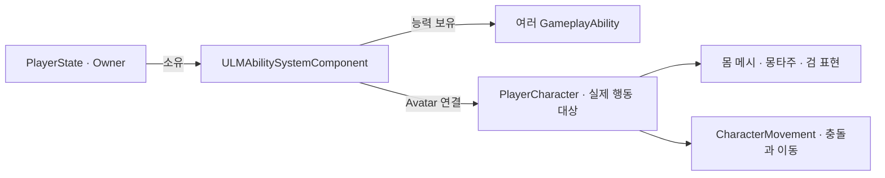
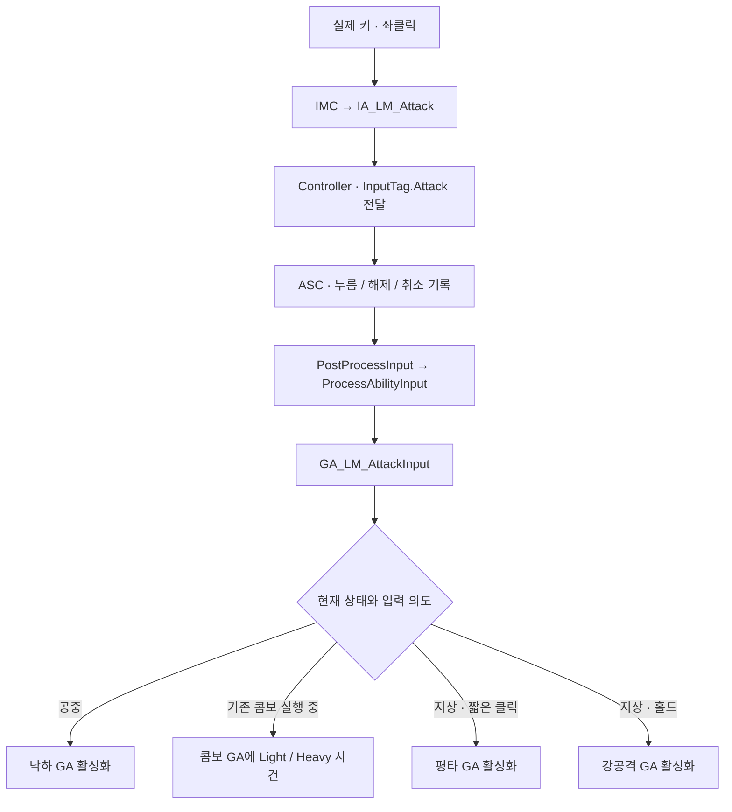

# LM GAS 구조 안내 — C++·블루프린트 역할과 능력 확장 방법

> 작성 기준: 2026-11-03 / UE 5.8 계열 / 로컬 C++ 작업본과 현재 공격 구현안.
> 대상: 캐릭터·전투·AI·애니메이션 기능을 함께 개발하는 팀원.
> **현재 작성된 기반과 앞으로 연결할 설계를 함께 설명한다. 문서에 등장하는 모든 클래스와 BP가 구현 완료된 것은 아니다.**

**읽는 순서:** 처음 보는 팀원은 1~4절로 개념과 역할을 파악한다. 실행 원리는 5~8절, 새 기능을 추가하는 절차는 9~11절, 후속 범위와 팀 검증 기준은 12~14절에서 확인한다.

## 1. 먼저 알아둘 핵심

LM은 **캐릭터마다 ASC 하나를 두고, 그 ASC에 여러 GA를 부여하는 구조**를 사용한다. 공통 기반은 C++로 만들고, 개별 행동의 애니메이션·순서·연계와 설정은 블루프린트와 데이터 애셋으로 구성한다.

예를 들어 공격을 추가할 때마다 PlayerState에 `ComboAbility`, `HeavyAbility`, `PlungeAbility` 변수를 늘리는 대신, AbilitySet의 능력 목록에 새 GA를 등록한다. 플레이어와 몬스터는 같은 ASC 클래스를 사용할 수 있으며, 각각 자신만의 ASC 인스턴스와 능력 목록을 가진다.

팀에 설명할 때는 다음 다섯 문장으로 시작하면 된다.

1. **ASC는 능력을 보관하고 실행을 관리하는 공통 기반이다.** 평타나 해킹의 세부 규칙은 모른다.
2. **GA는 행동 하나의 시작 조건·실행 과정·종료를 담당한다.** 여러 프레임에 걸쳐 애니메이션과 사건을 기다릴 수 있다.
3. **AbilitySet은 누구에게 어떤 능력을 줄지 정하는 목록이다.** 능력을 부여하는 것과 실제 실행하는 것은 다르다.
4. **C++은 공통 계약과 정리를, BP는 행동별 흐름과 애셋 선택을 담당한다.** 검의 부착 위치와 표시도 캐릭터 BP에서 다룬다.
5. **새 기능은 GA와 데이터를 추가하는 방식으로 늘린다.** 공통 기반을 바꾸는 것은 여러 기능이 함께 필요로 하는 계약이 생겼을 때다.

### 현재 구현 상태

아래 표는 작성 시점의 소스·파일 확인 결과다. 이후 코드와 애셋을 연결하고 실행 검증하면 갱신한다.

| 구성 | 현재 확인한 상태 | 문서에서의 취급 |
| --- | --- | --- |
| `ULMAbilitySystemComponent` | 입력 큐·능력 활성화·입력 취소 코드 작성됨 | 현재 기반 구현 |
| `ULMAbilitySet` / `FLMAbilitySetGrantedHandles` | 여러 GA 부여·핸들 기록·기록한 능력 회수 코드 작성됨 | 현재 기반 구현 |
| `ALMPlayerState` | ASC 소유, Owner/Avatar 연결, 기본 AbilitySet 부여 코드 작성됨 | 현재 기반 구현 |
| `ALMPlayerCharacter` | ASC 접근, 상태 태그에 따른 이동 정책, 착지 사건 전송 코드 작성됨 | 현재 기반 구현, 연결 해제 보완 필요 |
| `ALMPlayerController` | 입력 연결 구조체와 일부 선언 작성 중, CPP의 공통 입력 전달은 미연결 | 진행 중 |
| `ALMBaseCharacter` | 공통 상속 기반만 있음 | 공통 GAS 연결까지 완료된 상태는 아님 |
| `ULMAttackAbility` | 해당 소스 파일 없음 | 아래에서 설명하는 다음 구현 대상 |
| 공격 입력·평타·강공격·낙하 GA BP, 공격 AbilitySet | 제안한 이름의 저장 애셋을 현재 Content에서 확인하지 못함 | 구현안; BP 그래프·실행 완료로 판정하지 않음 |
| 피해 GE·전투 AttributeSet·피격/사망 GA | 현재 공격 모션 단계의 후속 작업 | 확장 방향 |

**코드가 작성되어 있다는 사실과 기능이 동작한다는 사실은 구분한다.** 현재 빌드 성공·BP 컴파일·PIE 검증 완료를 주장하는 문서가 아니다. 작성 시점의 기존 빌드 로그에는 `Source/Lumia/Lumia.cpp`와 `Source/Lumia/Private/Lumia.cpp`의 중복 입력 파일명 오류가 남아 있다. Controller 선언도 작성 중이므로 실제 연결 전에 사용자 빌드 검증이 필요하다.

## 2. 용어를 프로젝트 역할로 이해하기

| 용어 | 쉬운 설명 | LM에서의 예 |
| --- | --- | --- |
| GAS | 행동·상태·효과를 같은 규칙으로 관리하는 언리얼 프레임워크 | 공격, 회피, 피격, 스킬을 같은 기반에서 처리 |
| ASC | 한 소유자의 능력 등록·실행·태그·효과를 관리하는 컴포넌트 | `ULMAbilitySystemComponent` |
| GA | 실행 가능한 행동의 규칙과 수명 | 평타 한 콤보의 시작부터 종료까지 |
| AbilitySet | 부여할 GA 클래스·레벨·입력 태그 목록 | 플레이어 기본 능력 묶음, 장비 능력 묶음 |
| AbilitySpec | 특정 ASC에 부여된 능력 한 건의 기록 | 클래스, 레벨, 입력 태그, 출처, 실행 상태 |
| SpecHandle | 부여된 능력 한 건을 식별하는 값 | 장비가 준 능력만 골라 회수할 때 사용 |
| Gameplay Tag | 상태·능력 종류·입력 등을 식별하는 계층형 이름 | `State.Dead`, `InputTag.Attack` |
| Gameplay Event | 지금 발생한 사건과 필요한 데이터를 전달하는 신호 | 실제 착지, 콤보 입력, 입력 구간 열림 |
| AbilityTask | GA가 실행 중에 기다리는 작업 | 몽타주 완료, 버튼 해제, 착지 사건 대기 |
| Gameplay Effect(GE) | 수치·태그 등에 적용하는 효과 | 이후 스태미나 비용, 피해, 버프, 쿨다운 |
| AttributeSet | GAS가 관리할 수치 정의 | 이후 Health, Stamina, IncomingDamage |

GA는 한 번 호출하고 바로 끝나는 일반 함수와 다르다. 실행 중 상태를 유지하며 애니메이션·입력·사건을 기다릴 수 있다. [Epic Gameplay Ability 설명](https://dev.epicgames.com/documentation/en-us/unreal-engine/using-gameplay-abilities-in-unreal-engine)

이번 단계에서 작성된 `ULMAbilitySet`은 **GA 목록만 부여한다.** GE와 AttributeSet을 함께 부여하는 기능까지 구현된 것으로 해석하지 않는다.

## 3. C++과 BP의 책임을 어떻게 나누는가

| 기능 | C++ 담당 | BP·에디터 담당 | 나누는 이유 |
| --- | --- | --- | --- |
| 능력 소유와 초기화 | ASC 생성, Owner/Avatar 연결 | GameMode의 실제 PlayerState·Pawn 클래스 지정 | 모든 행동이 같은 ASC에 접근해야 함 |
| 능력 부여 | AbilitySet 순회, Spec 생성, 부여 기록 | AbilitySet의 GA 클래스·레벨·입력 태그 편집 | 목록 변경 때문에 PlayerState 코드를 수정하지 않음 |
| 공통 입력 | 입력 큐, 정상 해제·취소 구분, 매 프레임 처리 | IA, IMC, Controller의 Ability Inputs | 키 설정과 행동 구현을 분리 |
| 공격 실행 공통부 | 조건 검사, 몽타주 Task, 종료 정리 | 공격별 몽타주·Section·연계 선택 | 같은 종료 코드를 여러 BP에 반복하지 않음 |
| 짧은 클릭·홀드 | ASC가 입력 사건 전달 | 입력 GA가 시간 기준으로 행동 선택 | 공격 입력 규칙을 Controller에 고정하지 않음 |
| 검 표시 | 별도 무기 표현 C++ 컴포넌트 불필요 | 캐릭터의 SwordMesh, 소켓, Show/Hide 함수 | 위치·회전·표시는 에디터에서 조정하기 쉬움 |
| 콤보 타이밍 | 사건을 받을 수 있는 공통 GAS 기반 | Notify State 위치, 콤보 GA의 다음 Section 선택 | 애니메이션 수정에 맞춰 입력 구간을 조정 |
| 이동 | CharacterMovement의 충돌·속도·접지 계산, 이동 정책 | GA가 이동 요청과 애니메이션 순서를 구성 | 물리 이동을 각 GA가 새로 구현하지 않음 |
| 피해·자원(후속) | 공통 계산·Attribute 변경 계약 | GE 값, 공격별 설정·연출 | 피해 공식과 표현을 한곳에 섞지 않음 |

BP에 맡긴다는 것은 책임을 없앤다는 뜻이 아니다. **C++이 제공하는 안전한 실행 단위를 BP에서 조합한다**는 뜻이다. 반대로 어떤 노드가 길어 보인다는 이유만으로 행동마다 새 C++ 클래스를 만들 필요도 없다.

## 4. Owner와 Avatar: 능력의 소유자와 실제 행동 대상

플레이어 구성은 다음과 같다.



- **Owner:** ASC와 능력 보유를 관리하는 Actor. 플레이어는 PlayerState다.
- **Avatar:** 현재 그 능력을 실제로 수행하는 Actor. 플레이어는 PlayerCharacter다.
- **SourceObject:** 그 능력을 누가 부여했는지 기록하는 출처. Owner나 Avatar를 설정하는 값이 아니다.

현재 PlayerState는 `InitAbilityActorInfo(this, PlayerCharacter)`로 이 관계를 연결한다. 같은 Avatar를 다시 초기화할 때는 `RefreshAbilityActorInfo()`를 사용한다.

이렇게 나누면 **같은 PlayerState를 유지하면서 Pawn을 교체할 때** 보유 능력과 실제 몸을 분리해 다룰 수 있다. 다만 연결만 바꾸면 모든 문제가 자동 해결되지는 않는다. 이전 Avatar의 능력 Task, 입력 대기, 몽타주, 태그 구독 등을 정리해야 한다. 현재 안내의 `DisconnectAbilitySystem()`은 이 보완을 위한 구현안이다.

PlayerState 자체가 사라지는 경우의 저장·복원이나 사망 후 어떤 GE를 유지할지는 별도 정책이다.

### 플레이어·몬스터·보스에서의 사용

| 대상 | ASC 소유 권장 위치 | Avatar | 행동 실행 요청 |
| --- | --- | --- | --- |
| 플레이어 | PlayerState | 현재 PlayerCharacter | Controller 입력 또는 사건 |
| 일반 몬스터 | 해당 몬스터 Actor | 해당 몬스터 자신 | AI 판단, 행동 트리/StateTree 등의 요청 |
| 보스 | 해당 보스 Actor | 해당 보스 자신 | AI 패턴·페이즈 판단 |

몬스터와 보스도 **같은 `ULMAbilitySystemComponent` 클래스의 별도 인스턴스**를 쓴다. 한 ASC 인스턴스를 모든 캐릭터가 함께 공유하는 것이 아니다.

AI는 마우스 입력을 흉내 낼 필요가 없다. 능력을 먼저 부여한 뒤 자신의 ASC에 `TryActivateAbility` 또는 `TryActivateAbilityByClass`로 실행을 요청할 수 있다. 실제 실행 가능 여부는 GA의 조건이 판단한다.

이 AI 초기화·해제 연결은 아직 구현 완료가 아니다. 첫 AI 연결 때 `ALMBaseCharacter`에 모을 공통 ASC 접근·수명 계약을 정리해야 한다. 플레이어 전용 캐스팅을 공통 ASC에 추가하는 방식으로 해결하지 않는다.

## 5. 게임 시작: AbilitySet이 능력을 준비하는 과정

현재 C++ 흐름은 다음과 같다.

```text
PlayerCharacter::PossessedBy
  → PlayerCharacter::InitializeAbilitySystem
  → PlayerState::InitializeAbilitySystem
  → ASC의 Owner / Avatar 연결
  → PlayerState::EnsureStartupAbilitiesGranted
  → 각 AbilitySet::GiveAbilities
  → ASC에 여러 AbilitySpec 등록 + 부여 핸들 기록
```

`FLMAbilitySetEntry`에는 다음 세 값이 있다.

| 값 | 의미 | 에디터에서 바꾸는 예 |
| --- | --- | --- |
| AbilityClass | 부여할 GA의 종류 | 평타, 회피, 스킬 BP 클래스 |
| AbilityLevel | 부여 시 기록할 레벨 | 1, 2 등. 실제 수치 활용은 능력/효과 구현에 따름 |
| InputTag | 해당 Spec을 어떤 입력과 연결할지 | `InputTag.Attack`; 입력이 없으면 비움 |

AbilitySet은 여러 캐릭터가 읽는 **공유 설정**이다. 현재 콤보 단계나 누르고 있는 시간 같은 실행 상태를 저장하지 않는다.

부여와 활성화도 다르다.

```text
부여: 이 캐릭터가 회피 능력을 사용할 수 있도록 등록한다.
활성화: 지금 회피를 시작할 수 있는지 검사하고 실행한다.
회수: 이 부여 기록을 제거해 더 이상 그 능력을 제공하지 않는다.
```

현재 PlayerState는 기본 AbilitySet을 최초 한 번 부여하고, 배열에 같은 AbilitySet이 중복 지정되면 한 번만 처리한다. 그러나 **서로 다른 AbilitySet에 같은 GA를 넣는 것까지 전역으로 중복 제거하지는 않는다.** 같은 입력 태그에 여러 Spec이 연결되면 여러 활성화를 시도할 수 있으므로 목록을 검토한다.

## 6. 입력 한 번이 GA 실행으로 이어지는 원리

아래는 Controller 연결을 완료한 뒤의 목표 흐름이다.



Mermaid를 지원하지 않는 뷰어에서는 위 코드를 텍스트로 볼 수 있다. 핵심 순서는 **키 → Input Action → InputTag → ASC → GA → 행동**이다.

### Controller는 입력의 의미까지 결정하지 않는다

Controller의 `Ability Inputs`는 다음 연결만 갖는다.

| Input Action | Input Tag |
| --- | --- |
| `IA_LM_Attack` | `InputTag.Attack` |

ASC는 AbilitySet이 Spec에 기록한 입력 태그를 찾아 처리한다. 현재 구현은 `GetDynamicSpecSourceTags().HasTagExact(InputTag)`로 정확히 일치하는 태그를 비교한다. GA의 Asset Tags에 `InputTag.Attack`만 추가하는 것으로는 이 연결을 대신할 수 없다.

### 입력을 즉시 실행하지 않고 큐에 모으는 이유

현재 ASC는 누름·해제·취소 순서를 보관하고 프레임 끝의 입력 처리 단계에서 소비한다.

- 아주 짧은 클릭의 누름과 해제가 같은 프레임에 들어와도 순서를 보존한다.
- 같은 처리 묶음에서 취소된 입력은 정상 클릭으로 실행하지 않는다.
- 최초 활성화에 사용한 누름을 실행 중 능력의 추가 누름으로 한 번 더 보내지 않는다.
- 처리 중 UI 전환 등으로 입력을 비우면 남은 오래된 입력을 계속 실행하지 않는다.

### 정상 해제와 취소는 다르다

| 사건 | 의미 | 공격 입력 GA의 기대 동작 |
| --- | --- | --- |
| Pressed | 버튼을 누름 | 클릭/홀드 판정 시작 |
| Released | 사용자가 정상적으로 놓음 | 짧은 클릭이면 평타 의도 확정 |
| Canceled / ClearAbilityInput | 입력 환경이 중단됨 | 공격으로 바꾸지 않고 입력 대기 취소 |

포커스 상실을 Released로만 해석하면 의도하지 않은 평타가 나올 수 있다. Controller의 `FlushPressedKeys`·UI 전환 정리에서 입력 취소 경로를 사용하려는 이유다.

`ClearAbilityInput()`은 대기·누름 상태인 입력 연결 능력을 정리한다. **이미 별도로 시작한 모든 공격 GA를 취소하는 명령은 아니다.** 전체 행동 중단은 취소 대상 능력 태그와 상태 정책으로 따로 요청한다.

## 7. 공격에서 C++ 부모와 BP 자식이 협력하는 방법

다음은 현재 합의한 공격 구현안이다. 이 절의 부모·BP 생성은 현재 소스 확인 기준으로 다음 작업에 해당한다.

```text
UGameplayAbility
├─ GA_LM_AttackInput               : 짧은 클릭 / 홀드 / 공중 분기
├─ ULMAttackAbility               : 공격 공통 C++ 부모
│  ├─ GA_LM_PlayerAttackBase       : 플레이어 검 표시 종료 정리
│  │  ├─ GA_LM_PlayerCombo         : 평타 3단과 2→3 특수 전환
│  │  ├─ GA_LM_PlayerHeavy         : 강공격 1종
│  │  └─ GA_LM_PlayerPlunge        : 실제 하강과 착지 마무리
│  └─ 몬스터 / 보스 공격 BP        : 각 AI가 선택한 공격 실행
├─ 이동·회피 GA
├─ 피격·다운·기립·사망 GA
└─ 스킬·스캔·해킹 등의 GA
```

아래쪽 행동 목록은 수용할 역할을 설명한 것이며, 지금 모든 빈 클래스를 만들라는 뜻이 아니다. 공격하지 않는 행동은 공격 부모를 상속하지 않는다.

### 공격 부모 C++

`ULMAttackAbility`의 현재 모션 단계 책임은 다음과 같다.

| 함수/설정 | 역할 | 이유 |
| --- | --- | --- |
| `CanActivateAbility` | 기본 GAS 조건 + 지상/공중 조건 검사 | BP가 잘못 요청해도 공통 조건을 통과해야 실행 |
| `GetAttackCharacter` | Avatar를 `ACharacter`로 얻음 | PlayerCharacter에 종속되지 않음 |
| `PlayAttackMontage` | 몽타주 Task 생성, 완료·실패·중단 연결 | 자식 BP마다 종료 배선을 반복하지 않음 |
| `EndAbility` | 루트 모션 배율 등 공통 정리 후 부모 종료 호출 | 취소 후 다음 행동에 상태가 남는 것을 방지 |
| Activation Owned/Blocked Tags | 공격 상태와 중복 실행 제한 | 서로 다른 공격 GA에도 같은 기본 규칙 적용 |

`PlayAttackMontage`의 반환값은 **재생을 시작한 뒤 능력이 아직 활성 상태인지**를 뜻한다. 몽타주가 끝났다는 완료 결과가 아니다. 완료는 내부 AbilityTask가 나중에 전달한다. 몽타주 Task에는 정상 완료·중단·취소 출력이 있으므로 이 경로를 모두 다룬다. [Epic PlayMontageAndWait 설명](https://dev.epicgames.com/documentation/en-us/unreal-engine/BlueprintAPI/Ability/Tasks/PlayMontageAndWait)

이 최소 부모가 기획의 공통 공격 판정·피해 처리까지 완성한 것은 아니다. 이후 판정·피해·공격 결과 계약을 연결할 위치는 12절에 구분했다.

### 공격별 BP

| BP | 고유 책임 | 공통 부모에 맡기는 일 |
| --- | --- | --- |
| Combo | 콤보 입력 구간, 다음 Section 예약, 일반 3타/특수 전환 선택 | 몽타주 Task와 종료 |
| Heavy | 강공격 몽타주·시작 Section 지정 | 조건·상태·완료/취소 정리 |
| Plunge | 착지 사건 대기, 하강 요청, End Section 이동 | 몽타주 실행 수명과 종료 |
| PlayerAttackBase | `OnEndAbility → HideSword` | 일반적인 공격 실행 규칙 |

플레이어 검 메시를 다루는 캐스팅은 플레이어 BP 부모에 둔다. 공통 C++ 공격 부모와 ASC는 검 소켓이나 플레이어 메시 이름을 알 필요가 없다.

### 한 번의 공격 예시

1. 좌클릭을 누르면 입력 GA가 실행된다.
2. `0.25초` 전에 정상 해제하면 Light 의도를 한 번 확정한다. `0.25초`는 초기 조정값이다.
3. 콤보가 실행 중이 아니면 Combo GA를 활성화하고 입력 GA는 종료한다.
4. Combo GA가 `State.Action.Attacking`, `State.Movement.External`, `State.Attack.Combo`를 소유한다.
5. 캐릭터는 현재 태그를 읽어 일반 이동을 제한한다. 몽타주의 루트 이동과 캐릭터 충돌은 별도 엔진 경로로 처리한다.
6. 검 표시 Notify가 오면 캐릭터 BP의 `ShowSword`를 호출한다.
7. 다음 클릭을 받으면 입력 GA가 다시 의도를 해석하여 실행 중인 Combo GA에 사건을 보낸다.
8. Combo GA는 열린 입력 구간에서 다음 Section을 예약한다.
9. 몽타주가 끝나면 GA가 종료되고 검이 숨겨진다. 이 능력이 소유한 태그가 제거되면 캐릭터가 이동 정책을 다시 계산한다.

입력 GA가 끝나도 실제 공격 GA는 계속 실행된다. 두 능력의 수명이 다르므로 입력 GA의 종료에서 검이나 공격 몽타주를 정리하면 안 된다.

### 콤보·낙하 규칙

| 상황 | 처리 |
| --- | --- |
| 대기 중 짧은 클릭 | Attack01 시작 |
| 1타 입력 구간에서 Light 확정 | Attack01 다음을 Attack02로 예약 |
| 2타 입력 구간에서 Light 확정 | Attack02 다음을 Attack03으로 예약 |
| 2타 입력 구간에서 Heavy 확정 | Attack02 다음을 IaiDraw로 예약, 이후 Thunderclap |
| 대기 중 홀드 완료 | Heavy GA 한 번 실행; 이후 해제로 평타를 추가 실행하지 않음 |
| 공중에서 공격 의도 확정 | Plunge GA → 실제 하강 → Landed 사건 → End Section |

ComboWindow Notify State는 열림/닫힘 사건만 전송한다. 다음 공격의 선택과 `bComboWindowOpen`, `bHeavyQueued` 같은 실행 상태는 GA 인스턴스가 보관한다.

이 구현안은 **입력 확정 순간에 콤보 구간이 열려 있는지** 검사한다. 구간 밖 입력을 나중에 실행하는 별도 버퍼는 아직 없다. 낙하 착지는 고정 Delay로 추측하지 않고 현재 Character의 `Landed()` 사건을 사용한다.

## 8. 태그·사건·종료에 대한 공통 계약

### 이름이 비슷해도 용도가 다르다

| 종류 | 질문에 대한 답 | 예 | 기록/처리 위치 |
| --- | --- | --- | --- |
| InputTag | 어떤 입력으로 시작할 능력인가? | `InputTag.Attack` | Controller 설정 ↔ AbilitySet의 Spec 태그 |
| Ability 태그 | 어떤 종류의 능력인가? | `Ability.Attack.Combo` | GA Asset Tags, 취소 대상 분류 |
| State 태그 | 지금 어떤 상태인가? | `State.Action.Attacking` | ASC의 현재 태그, 조건과 정책 검사 |
| Event 태그 | 방금 무엇이 발생했는가? | `Event.Combat.Combo.Open` | Send/Wait Gameplay Event |

현재 Native Tag에는 `InputTag.Attack`, 입력 차단·이동·사망·기절 상태, `Event.Movement.Landed`가 등록되어 있다. `Ability.Attack.*`, `State.Action.Attacking`, 콤보 관련 사건은 공격 구현 시 추가할 대상이다.

### 조건 검사와 실행 중 취소는 별개다

| 설정/호출 | 역할 |
| --- | --- |
| Activation Required/Blocked Tags | **시작 시점**에 실행 가능한지 검사 |
| Activation Owned Tags | 능력이 실행되는 동안 소유하고 종료 시 제거하는 상태 |
| Cancel Abilities with Tag / 명시적 취소 | 이미 실행 중인 능력에 취소 요청 |
| `EndAbility` | 현재 능력의 실행 수명을 마침 |

공격의 Blocked Tags에 `State.Stunned`를 넣는 것만으로 실행 중 공격이 기절 순간 자동 취소되지는 않는다. 이후 피격·기절·사망 구현에서는 해당 상태 정책이 `Ability.Attack` 및 필요한 입력 능력을 명시적으로 취소해야 한다. 취소 불가능한 능력은 별도 정책을 확인한다.

입력 GA는 콤보 중에도 실행되어야 하므로 `State.Action.Attacking`으로 막지 않는다. 반면 실제 공격 GA에는 중복 공격을 막는 조건을 둔다.

### 정상 종료뿐 아니라 중단도 같은 품질로 처리한다

| 정리 대상 | 담당 원칙 |
| --- | --- |
| GA 소유 AbilityTask, Activation Owned Tags | GAS의 종료 경로 사용; C++에서는 `Super::EndAbility()` 호출 |
| 검 표시 | 플레이어 공격 BP 부모가 HideSword |
| 루트 모션 배율 | 그것을 변경한 공격의 공통 종료 처리 |
| 이동 가능 여부 | 기본 정책 + 현재 남은 태그로 재계산 |
| 능력에서 별도로 건 외부 델리게이트·일반 타이머·카메라 변경 | 해당 능력/담당 시스템에서 직접 정리 |
| 이미 지불한 비용, 이미 적용한 효과 | 별도로 정한 게임 규칙에 따라 처리; 취소가 자동 환불은 아님 |

공격 종료 시 `AllowMove = true`를 무조건 설정하면 아직 기절 중인 캐릭터도 움직일 수 있다. 현재 `RefreshMovementPolicyFromAbilities()`가 매번 기본 정책과 남은 상태를 합산하는 이유다.

`Instanced Per Actor` 능력의 실행 객체는 재사용될 수 있으므로 콤보 플래그·입력 확정 플래그 등은 **Activate 시점에 다시 초기화한다.** AbilitySet·Notify 애셋에 캐릭터별 실행 상태를 저장하지 않는다.

## 9. 새 GA를 추가하는 표준 작업 순서

### 먼저 행동의 계약을 정한다

새 능력마다 다음 항목을 짧게 작성한다.

| 항목 | 작성 예 |
| --- | --- |
| 목적 | 회피, 스캔, 보스 내려찍기 |
| 시작 요청 | 플레이어 키, AI, Gameplay Event, 장착 시점 |
| 실행 조건 | 지상/공중, 사망·기절 여부, 필요한 대상 |
| 비용·쿨다운 | 없음 또는 사용할 GE; 비용 확정 시점 |
| 실행 중 상태 | 소유할 State 태그, 제한할 행동 |
| 정상 종료 | 몽타주 완료, 지속 시간 종료, 사건 도착 |
| 취소 조건 | 피격, UI 전환, 대상 소실, Avatar 교체 |
| 취소 정리 | 이동·카메라·표시·외부 구독 등 복구할 항목 |
| 부여·회수 주체 | 기본 AbilitySet, 장비, AI 생성/풀 재사용 |

### 예시 A: 플레이어 회피 GA 추가

아래 이름과 태그는 확장 예시이며 현재 생성된 기능을 뜻하지 않는다.

1. `GA_LM_Dodge`를 만든다. 회피는 공격 부모를 상속하지 않는다. 현재는 `GameplayAbility` 기반으로 시작할 수 있다.
2. 실행 조건과 Owned/Blocked Tags를 정한다. 실제 충돌·물리 이동은 CharacterMovement 또는 적절한 이동 Task를 사용한다.
3. BP에서 Activate → 실행 → 정상 종료를 연결하고, 실패·취소 시 복구도 구현한다.
4. `InputTag.Dodge`를 프로젝트 Native Tag 위치에 추가한다.
5. 에디터에서 `IA_LM_Dodge`를 만들고 사용 중인 IMC에 키를 매핑한다.
6. Controller BP의 Class Defaults → Ability Inputs에 `IA_LM_Dodge / InputTag.Dodge`를 추가한다.
7. 실제 사용하는 AbilitySet에 `GA_LM_Dodge`, 레벨, `InputTag.Dodge`를 등록한다.
8. 재시작한 PIE에서 연속 입력·입력 취소·피격 중단·다른 상태와의 충돌을 확인한다.

**한 키가 회피 하나만 실행하면 공격처럼 별도의 입력 해석 GA를 만들 필요가 없다.** 같은 키의 클릭/홀드가 여러 행동을 선택할 때만 그 분리의 이점이 있다.

Controller·ASC·PlayerState가 회피 이름을 알아야 하는 것은 아니다. 현재 공통 입력 연결을 완성한 뒤에는 데이터 등록으로 연결한다. 기존 기반이 제공하지 않는 이동·상태 계약이 실제로 필요할 때만 C++을 보강한다.

### 예시 B: 같은 공격 기반으로 몬스터·보스 추가

1. 해당 캐릭터가 자신의 ASC를 생성하고 GAS 인터페이스로 반환하도록 연결한다.
2. Owner와 Avatar를 올바르게 초기화한다. Actor 소유 방식에서는 둘 다 해당 캐릭터를 가리킬 수 있다.
3. 몬스터용 AbilitySet에 공격 GA를 등록한다. 플레이어 입력을 받지 않으면 InputTag는 비운다.
4. 공격 GA는 공통 `ULMAttackAbility`를 사용하고, 몽타주와 다음 단계 선택은 해당 BP에서 구성한다.
5. AI는 거리·대상·페이즈를 판단하여 이미 부여된 능력의 활성화를 요청한다.
6. 능력의 완료·중단·실패와 AI의 다음 행동을 연결한다. **활성화 성공은 적중 성공이나 공격 완료를 뜻하지 않는다.**
7. 사망·제거·풀 반환 시 능력 실행과 Task·효과·타깃 상태를 정책에 맞게 정리한다.

일반 몬스터와 보스에 새 ASC 하위 클래스를 각각 만드는 것으로 시작하지 않는다. 같은 ASC에서 충분히 표현되는 차이는 AbilitySet·GA·AI 판단 데이터로 구성한다.

풀링은 Actor가 삭제되지 않으므로 `EndPlay()`만으로 재사용 정리가 되지 않는다. 다시 꺼냈을 때 이전 체력·사망 태그·타이머·능력이 남지 않는 초기화/해제 계약이 필요하며, 현재 구현 완료 항목은 아니다.

### 예시 C: 장비가 능력을 주고 해제 시 회수

1. 장비용 AbilitySet을 준비한다.
2. 장비를 관리하는 런타임 객체가 자기 `FLMAbilitySetGrantedHandles` 기록을 가진다.
3. 장착 시 `GiveAbilities(ASC, 장비출처객체, 해당기록)`로 부여한다.
4. 장착 해제 시 실행 중 스킬을 즉시 취소할지 끝까지 허용할지 정책을 먼저 적용한다.
5. 해당 기록의 `RemoveFromAbilitySystem()`으로 그 장비가 부여한 능력만 회수한다.

다른 장비·기본 능력을 함께 지우는 `ClearAllAbilities()`를 장착 해제의 기본 방법으로 사용하지 않는다. 같은 GA 클래스라도 부여 건이 다르면 SpecHandle로 구분할 수 있다.

현재 `GiveAbilities`와 회수 함수는 C++ API다. 장비의 장착/해제 호출 흐름이나 BP용 함수까지 만들어진 것은 아니다. 장비 기능을 구현할 때 필요한 연결만 추가한다. 하나의 부여 기록에 서로 다른 ASC나 서로 다른 장비의 수명을 섞지 않는다.

## 10. 에디터에서 연결할 항목 빠르게 찾기

아래 공격 애셋 이름과 새 폴더는 구현안이다. 기존 애셋이 있으면 중복 생성하지 않고 실제 연결을 확인한다. `GA`, `DA`, `AN`, `ANS`는 이 문서의 역할별 명명안이며 팀 명명표의 확정 항목과 구분한다.

| 작업 | 위치/화면 | 설정할 내용 |
| --- | --- | --- |
| 실제 클래스 선택 | `BP_LM_GameMode` → Class Defaults | PlayerState, PlayerController, Default Pawn 클래스 |
| 레벨 적용 | World Settings → GameMode Override | 테스트에서 사용할 GameMode |
| 기본 능력 묶음 | `BP_LM_PlayerState` → Startup Ability Sets | `DA_LM_PlayerStartupAbilities` |
| 능력 목록 | 위 Data Asset → Abilities | GA Class, Level, InputTag |
| 키 배치 | 사용 중인 `IMC_LM_Player` | Input Action과 실제 키 |
| 키와 GAS 연결 | Controller BP → Ability Inputs | Input Action과 InputTag |
| 몸 애니메이션 경로 | 캐릭터 ABP의 AnimGraph / Class Defaults | 몽타주와 같은 Slot, Root Motion 설정 |
| 공격 순서 | 몽타주의 Montage Sections | 기본 연결과 반복 구간 |
| 콤보 타이밍 | 몽타주의 Notify 트랙 | `ANS_LM_ComboWindow` 시작/끝 |
| 검 위치와 표시 | 캐릭터 BP, 몸 Skeleton | `SwordMesh`, 오른손 소켓, Show/Hide 함수 |

공격 AbilitySet의 목표 목록은 다음과 같다.

| Ability Class | Level | InputTag |
| --- | --- | --- |
| `GA_LM_AttackInput` | 1 | `InputTag.Attack` |
| `GA_LM_PlayerCombo` | 1 | 비움 |
| `GA_LM_PlayerHeavy` | 1 | 비움 |
| `GA_LM_PlayerPlunge` | 1 | 비움 |

실제 공격 세 개에 좌클릭 태그를 중복 연결하지 않는다. 입력 GA가 선택해서 활성화한다. 플레이어 공격 BP 부모 자체도 부여 목록에 넣지 않는다.

검은 **오른손 소켓에 부착 + 평소 Hidden in Game + 공격 Notify에서 표시 + 실제 공격 종료에서 숨김**으로 구성한다. 칼집과 별도 `LMWeaponPresentationComponent`는 이 구성에 포함하지 않는다. 손 자세·소켓 보정·애니메이션 제작은 GA의 역할이 아니다.

## 11. 이후 행동들도 같은 기반을 사용하되 역할을 구분한다

| 앞으로의 행동 | GA가 맡을 일 | GA 밖에 남길 일 |
| --- | --- | --- |
| 평타·강공격·낙하 | 허용 조건, 실행, 연계, 종료 | 애니메이션 제작, 메시 부착 위치 |
| 회피·공중 대시 등 | 행동 수명, 비용, 허용·취소 조건 | 실제 이동·충돌 처리 |
| 피격·다운·기립·사망 | 해당 반응 실행과 종료 | 상위 상태 전환·부활·풀 정책 |
| 하드웨어 스킬 | 실행, 비용·쿨다운 | 장비 획득·장착·저장 |
| 스캔 | 스캔 행동의 허용·중단 | 기존 ScanComponent의 탐색·표현 |
| 해킹 | 시작·진행·취소 | 퍼즐 정답과 장치의 영속 해금 상태 |
| 공격 연계 패링 | 공격 구간과 판정 결과에 연결 | 임의의 별도 패링 키로 기획 변경하지 않음 |
| 락온·오토 포커싱 | 필요할 때 요청과 조건을 표현 | 타깃 유지·카메라 계산 |

현재 이동·점프·카메라·스캔의 기존 코드를 모두 GA로 옮긴 것은 아니다. 예를 들어 점프와 스캔은 기존 직접 호출 흐름이 있다. 전환할 때는 기존 입력과 새 GA가 같은 행동을 두 번 실행하지 않게 한 기능씩 바꾼다. 지상 대시로 부르는 Shift 달리기 토글과 별도 회피·공중 대시도 구분한다.

ASC가 여러 GA를 가질 수 있다는 것은 모든 GA를 동시에 실행한다는 뜻이 아니다. 어떤 행동을 함께 허용하고 어떤 행동끼리 막을지는 태그·취소 규칙·상위 상태 정책으로 정한다.

## 12. 피해·스태미나와 공통 공격 판정은 다음 단계다

이번 모션 단계의 목표는 평타 3단, 강공격, 2→3 특수 전환, 실제 착지 기반 낙하 공격의 실행·연계·종료다. 이것만으로 P02 전체가 완료되지는 않는다.

기획상 공통 피해 흐름은 다음 책임을 수용해야 한다.

```text
공격의 판정 구간
  → 대상과 공격 결과 판정
  → 유효한 피해에 공통 GameplayEffect 적용
  → ExecutionCalculation에서 계산
  → 전투 AttributeSet의 IncomingDamage 처리
  → Health 변경
  → 피격·사망 반응 요청
```

이 공통 경로는 현재 구현 완료가 아니다. 후속 구현에서는 다음을 지킨다.

- 개별 공격 BP마다 Health를 직접 빼는 로직을 복사하지 않는다.
- 적중·회피·패링 같은 **공격 결과**와 최종 피해량을 구분한다.
- 공통 공격 부모 또는 공통 판정 계층이 판정/결과 계약을 제공하고, 자식 GA는 결과에 따른 다음 공격 선택을 담당하게 한다.
- 실제 피해 공식, 비용 확정 시점, 취소 시 환불·입력 처리 규칙은 기획에 맞춰 확정한다.
- `CommitAbility()` 호출만으로 스태미나 차감이 생기지 않는다. 사용할 AttributeSet과 Cost GE가 연결되어야 한다.
- 비용은 실제 행동 GA에 둔다. 입력 해석 GA에서 같은 비용을 중복 지불하지 않는다.

Lyra에서 가져오는 핵심은 공통 ASC, 데이터 기반 능력 부여, 입력 전달, 능력 수명 관리다. 현재 LM에 Lyra의 모든 Experience·GameFeature·장비 프레임워크가 도입된 것은 아니다. [Epic Lyra 능력 구조](https://dev.epicgames.com/documentation/en-us/unreal-engine/abilities-in-lyra-in-unreal-engine)

## 13. 팀 작업과 검증 기준

### 누가 어느 부분을 바꾸는가

| 작업 종류 | 우선 수정할 대상 |
| --- | --- |
| 클릭/홀드 판정 기준 조정 | 공격 입력 GA의 설정·흐름 |
| 공격 애니메이션 교체 | 공격 GA BP의 몽타주와 몽타주 내부 Sequence |
| 콤보 가능 타이밍 변경 | Notify State 구간 |
| 다음 공격 선택 변경 | Combo/보스 공격 GA의 분기 |
| 캐릭터에게 새 능력 제공 | 해당 AbilitySet과 필요 시 입력 설정 |
| 모든 공격의 종료 결함 | 공통 공격 부모의 종료 처리 |
| 모든 입력의 취소 결함 | Controller 입력 경계와 ASC 공통 처리 |
| 검 위치·회전 조정 | Skeleton 소켓과 캐릭터 BP |
| 피해 공식 변경 | 후속 공통 계산·Attribute 경로 |

### 최소 확인 항목

- [ ] 실제 GameMode의 PlayerState·Controller·Pawn이 의도한 클래스다.
- [ ] Owner/Avatar 연결 후 필요한 능력이 한 번씩 부여된다.
- [ ] 짧은 클릭, 홀드, 같은 프레임의 빠른 누름·해제에서 중복 실행되지 않는다.
- [ ] 입력 취소가 평타로 바뀌지 않는다.
- [ ] 콤보 구간에서만 다음 공격이 예약되고 입력 없이 자동 연속 재생되지 않는다.
- [ ] 몽타주 실패·중단·강제 취소에서도 능력이 끝난다.
- [ ] 종료 후 검·이동·루트 모션·외부 구독이 필요한 상태로 복구된다.
- [ ] 기절 등 다른 제한이 남아 있으면 공격 종료 후에도 그 제한을 유지한다.
- [ ] 실제 착지 사건으로 낙하 마무리가 시작된다.
- [ ] Avatar 교체, 장비 해제, AI 풀 재사용 시 이전 실행 상태가 남지 않는다.
- [ ] 피해·비용을 추가한 단계에서는 중복 적용과 취소 정책도 확인한다.

콘솔 `showdebug abilitysystem`으로 부여된 능력, 활성 상태, 태그를 확인할 수 있다. C++ 빌드 성공과 BP 연결 성공, 실제 플레이 검증은 별도로 기록한다.

### Git과 Perforce의 연결도 함께 기록한다

- C++과 이 팀 문서는 프로젝트의 Dev Git에서 관리한다. 검토한 파일만 명시적으로 stage한다.
- BP·몽타주·Data Asset·맵·프로젝트 설정은 기존 Perforce 관리 규칙을 따른다. Markdown은 P4에서 제외한다.
- C++에 추가한 함수·태그를 BP가 사용하면 **맞는 Git 코드와 P4 애셋 버전**이 함께 필요하다.
- 변경 인수인계에는 관련 Git 커밋, P4 변경 번호, 실행 검증 결과, 남은 연결 작업을 적는다.
- 이 문서 작성만으로 커밋·푸시·P4 Submit이 수행되지는 않는다.

현재는 싱글플레이 기준이며 PlayerState의 ASC 복제도 꺼져 있다. GA의 `LocalPredicted` 설정이나 입력 사건 API 이름만으로 멀티플레이 대응이 완료되는 것은 아니다. 네트워크를 도입할 때는 서버 권한, ActorInfo 초기화, 입력 사건 전달, 예측·복제 정책을 별도로 검증한다.

## 14. 관련 소스 찾기

아래 경로는 프로젝트 루트 기준이다. 개인 PC 경로에 의존하지 않도록 상대 위치로 표기했다.

| 역할 | 경로/현재 상태 |
| --- | --- |
| ASC 선언·구현 | `Source/Lumia/Public/LMAbilitySystem/LMAbilitySystemComponent.h`, `Source/Lumia/Private/LMAbilitySystem/LMAbilitySystemComponent.cpp` |
| AbilitySet·부여 기록 | `Source/Lumia/Public/LMAbilitySystem/LMAbilitySet.h`, `Source/Lumia/Private/LMAbilitySystem/LMAbilitySet.cpp` |
| 플레이어 ASC 소유 | `Source/Lumia/Public/LMPlayer/LMPlayerState.h`, `Source/Lumia/Private/LMPlayer/LMPlayerState.cpp` |
| 공통 입력 연결 | `Source/Lumia/Public/LMPlayer/LMPlayerController.h`, `Source/Lumia/Private/LMPlayer/LMPlayerController.cpp` — 작성 중 |
| 현재 Avatar 연결·이동 정책·착지 | `Source/Lumia/Public/LMCharacter/LMPlayerCharacter.h`, `Source/Lumia/Private/LMCharacter/LMPlayerCharacter.cpp` |
| 공통 캐릭터 상속 기반 | `Source/Lumia/Public/LMCharacter/LMBaseCharacter.h` |
| Native Tag | `Source/Lumia/Public/LMGameplayTags/LMGameplayTags.h`, `Source/Lumia/Private/LMGameplayTags/LMGameplayTags.cpp` |
| 다음에 추가할 공격 부모 | `Source/Lumia/Public/LMCombat/LMAttackAbility.h`, `Source/Lumia/Private/LMCombat/LMAttackAbility.cpp` — 아직 없음 |
| 팀 명명·검증 규칙 | `AGENTS.md`, `README_CODE.ko.txt` |
| 팀 문서 공유 규칙 | `Docs/LMContext/SHARING.ko.md` |

문서 작성 시에는 C++와 애셋 파일 목록, 기존 빌드 로그를 읽었다. Unreal Editor의 현재 BP 그래프·Class Defaults를 직접 확인하거나 빌드·UHT·BP 컴파일·PIE를 실행하지 않았다. 팀 설명 자료의 완성과 게임 기능의 구현 완료는 구분한다.
